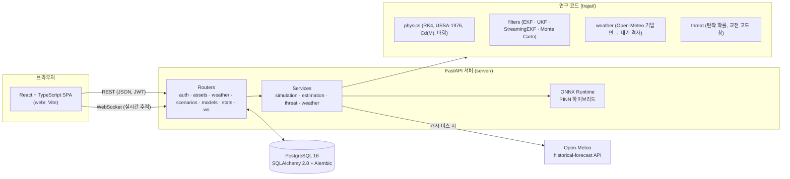
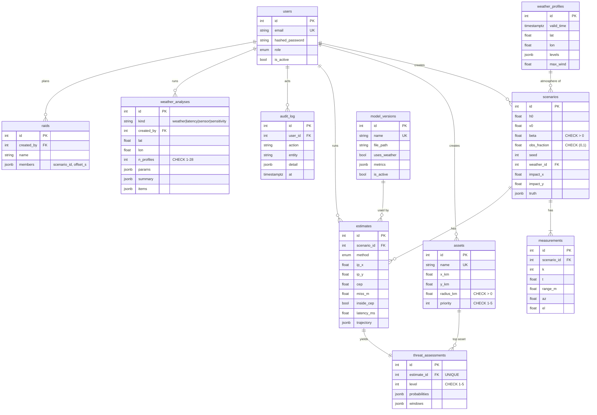
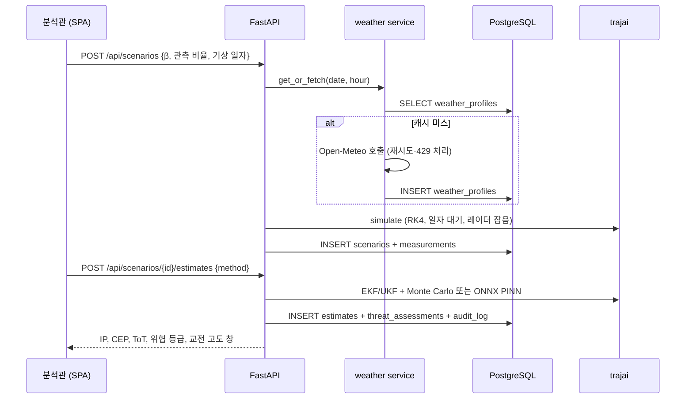

# TrajAI-Defense — 풀스택 아키텍처

이 문서는 운용 콘솔(프론트엔드), API 서버(백엔드), 데이터베이스, 그리고 연구 코드(`trajai/`)가 어떻게 맞물리는지 설명합니다.

## 1. 시스템 구성



| 계층 | 기술 | 역할 |
|---|---|---|
| 프론트엔드 | React 18, TypeScript 5 (strict), Vite 5, TanStack Query, React Router | 대시보드(교전 우선순위), 시나리오 생성(위치·일자별 기상), 상세·실시간 재생, 기상 영향 분석, 자산 CRUD, 모델 레지스트리, 사용자·감사 로그 |
| 백엔드 | FastAPI, Pydantic v2, Uvicorn, PyJWT, bcrypt | REST + WebSocket API, 역할 기반 접근 제어, 입력 검증, OpenAPI 문서(`/api/docs`) |
| 데이터베이스 | PostgreSQL 16 (개발·테스트는 SQLite), SQLAlchemy 2.0 ORM, Alembic | 11개 테이블, FK·CHECK·UNIQUE 제약, JSONB, 마이그레이션 4개 |
| 모델 서빙 | ONNX Runtime (CPU) | PINN 하이브리드 추론, 동적 트랙 길이 |
| 운영 | Docker 멀티 스테이지, Docker Compose, GitHub Actions | 단일 컨테이너(API + SPA) 배포, CI(코어·API·웹) |

## 2. 데이터 모델 (ERD)



설계 결정:

- **측정은 정규화된 테이블**(`measurements`, `UNIQUE(scenario_id, k)`)로 둡니다. 실시간 재생이 측정을 순서대로 읽고, 다른 추정기가 같은 측정을 재사용하기 때문입니다. 반면 진짜 궤적과 예측 궤적은 그리는 용도로만 쓰이므로 `JSONB`로 둡니다.
- **기상 프로파일은 (시각, 위치) 유일 키로 캐시**합니다. 같은 일자를 다시 요청하면 외부 API를 호출하지 않습니다. 이 동작은 테스트에서 호출 횟수로 확인합니다.
- **기상 영향 분석은 결과를 통째로 저장**합니다(`weather_analyses`, 시각별 행은 `JSONB`). 분석 하나는 최대 28개 프로파일로 작고, 항상 함께 읽히며, 다시 계산하면 외부 API를 또 불러야 하기 때문입니다. 기상 조회는 0.25° 격자로 맞춰 캐시 적중률을 높이고, `data/weather/`의 월 단위 내려받기 파일이 있으면 네트워크보다 먼저 읽습니다(제공자 429 제한 회피).
- **범위**: 목표 지점·발사 후보지를 주고 발사 시각·위치를 고르는 기능은 방어 측 예측이라는 목적과 맞지 않아 넣지 않았습니다.
- **삭제 정책**: 시나리오를 지우면 측정·추정·위협 평가가 함께 지워집니다(`CASCADE`). 사용자나 자산을 지우면 이력은 남기고 참조만 끊습니다(`SET NULL`).
- **PostgreSQL enum 타입**(`role`, `method`)은 마이그레이션 downgrade에서 명시적으로 제거합니다. 그렇지 않으면 upgrade를 다시 할 때 충돌합니다.

## 3. 주요 흐름

### 시나리오 생성 → 추정 → 위협 평가



### 실시간 추적 (WebSocket)

`/api/ws/scenarios/{id}/live?token=JWT&speed=8`에 연결하면, 저장된 측정을 실제 시간 간격(0.5 s ÷ 배속)에 맞춰 보냅니다. 서버의 `StreamingEKF`는 측정이 들어올 때마다 갱신되고 상태(β̂, 위치 불확실성, NIS)를 보냅니다. 이 스트리밍 EKF는 배치 EKF와 수치적으로 같은 결과를 냅니다(최종 상태 차이 < 2×10⁻⁵).

## 4. 보안

| 항목 | 구현 |
|---|---|
| 인증 | OAuth2 password flow, JWT(HS256, 만료 120분), bcrypt(cost 12) |
| 권한 | `viewer`(조회) < `analyst`(시나리오·추정·자산 생성/수정) < `admin`(사용자·모델·삭제). `require(role)` 의존성으로 라우터마다 적용 |
| 소유권 | 시나리오 삭제는 생성자 또는 admin만 |
| 입력 검증 | Pydantic 범위 제약 + DB CHECK 제약 (이중 방어) |
| 감사 | 로그인, 생성·수정·삭제, 추정 실행을 `audit_log`에 기록 |
| 비밀값 | `TRAJAI_JWT_SECRET`은 환경 변수로만 주입하며, Compose는 값이 없으면 시작을 거부합니다 |
| 자기 보호 | admin이 자신의 권한을 낮추거나 계정을 정지하는 것을 막음 |
| 무차별 대입 방지 | (이메일, 클라이언트 주소)별 슬라이딩 윈도: 5분 안에 5회 실패하면 HTTP 429 + `Retry-After`. 단일 워커 기준 메모리 상태이며, 다중 워커라면 Redis로 옮김 |
| 불확실성 보정 | PINN의 σ에 모델별 split-conformal 계수(`results/calibration.json`)를 곱한 뒤 위협 확률을 계산 |

## 5. 테스트 전략

| 수준 | 범위 | 도구 | 수 |
|---|---|---|---|
| 단위 (코어) | 대기 기준값, RK4 수렴 차수, 레이더 야코비안, EKF/UKF 일관성(NIS), 기상 격자·바람, 사용자 대기(습도·대류권계면), RTS 평활, β 사전, 위협 등급 | pytest | 21 |
| API 통합 | 인증 실패, RBAC, CRUD·검증·중복, 기상 캐시, 시뮬레이션, 추정·위협, 통계, WebSocket, 소유권, 감사 로그, 로그인 제한, CSV, 스키마 길이, 모델별 통계, 사용자 대기, 자료 지연·센서·민감도 분석, 다표적 교전, 위협 알림(WebSocket), 분포 밖 감지 | pytest + TestClient, **SQLite와 PostgreSQL 모두** | 24 |
| 마이그레이션 | upgrade → check(드리프트 없음) → downgrade → upgrade | Alembic | CI |
| 프론트엔드 단위 | API 클라이언트(토큰, 422 필드 오류, 401 처리, 폼 인코딩, 네트워크 오류), UI 컴포넌트, CSV 다운로드 | Vitest + Testing Library | 11 |
| E2E | 로그인 실패/성공, 대시보드, 시나리오 상세, 실시간 재생 완료, 폼 검증, viewer 읽기 전용, CSV 다운로드, 사용자 대기 시나리오, 환경 민감도·PDF, 다표적·비교, 위협 알림, 런타임 오류 없음 | Playwright (실제 서버 + PostgreSQL) | 12 |

E2E 테스트는 viewer에게 "새 시나리오" 버튼이 보이던 권한 표시 버그를 실제로 잡아냈습니다(서버는 403으로 막고 있었음).

## 6. 실행

```bash
# 로컬 개발 (SQLite)
pip install -r server/requirements.txt
cd server && uvicorn app.main:app --reload          # http://127.0.0.1:8000/api/docs
cd web && npm ci && npm run dev                      # http://127.0.0.1:5173 (API 프록시)

# PostgreSQL + 단일 컨테이너
export TRAJAI_JWT_SECRET=$(openssl rand -hex 32)
docker compose up --build                            # http://localhost:8000

# 데모 데이터와 정적 데모
python server/scripts/seed_demo.py                   # API로 시나리오 8개 생성 (실제 기상 5 · 표준 대기 3)
cd web && npm run build:demo && cd .. && python server/scripts/export_demo.py
```

Docker 이미지는 이 저장소의 작업 환경에서 Docker 데몬을 쓸 수 없어 빌드 검증을 하지 못했습니다. 대신 같은 구성(Uvicorn + PostgreSQL 16 + Alembic + 빌드된 SPA)을 직접 실행해 E2E 테스트를 통과했습니다.
